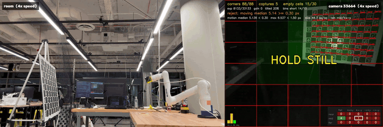

# PANOPTES

A motion capture system for Linux, built from scratch, on ten OptiTrack Prime
13W cameras.

PANOPTES has one job: **ground truth for VESPR**. VESPR is a UW GIX capstone
drone that perches on infrastructure and estimates its own state using only
onboard sensors (an Intel RealSense D435i). To show that the onboard estimate
is accurate, something independent has to measure where the drone really was.
That is PANOPTES.

**Mocap data never enters the drone's control loop.** PANOPTES is a measuring
instrument. If it helped fly the drone, the onboard estimate would prove
nothing.

## Why build it instead of buying Motive

OptiTrack's own software, Motive, runs only on Windows. The vendor's Linux
Camera SDK provides three things: camera control, hardware frame sync, and 2D
blob centroids. It provides nothing above that. So everything that turns
centroids into a pose is built here:

- calibration
- triangulation
- marker labeling
- rigid-body pose
- streaming

The SDK is also thinly documented, so its behaviour is measured on this
hardware rather than assumed. Those measurements are a large part of this
repo.

## Hardware

| | |
|---|---|
| Cameras | 10 × OptiTrack Prime 13W (legacy Prime series, not PrimeX) |
| Imager | 1280 × 1024, mono, global shutter, up to 120 Hz |
| Optics | 82° × 70° field of view, manual focus; 850 nm IR ring; switchable 850 nm bandpass filter |
| Network | Gigabit Ethernet with PoE, link-local addressing, one host NIC dedicated to the cameras |
| Mounting | 4 cameras low at the corners, 6 high (two per long side, one at each end), all aimed at one point. Remounted 2026-11-14; positions, aim and volume size are not yet re-measured ([top view](docs/panoptes_camera_layout.svg)) |
| Calibration target | calib.io ChArUco board: 12 × 9 squares of 60 mm (nominal), 45 mm markers, `DICT_5X5_100`, on aluminium; defined in [config/charuco_board.yaml](config/charuco_board.yaml) with caliper-measured sizes |
| Host | Linux (Ubuntu 24.04), C++17, OpenCV 4.6 (C++) and 5.x (Python) |

Specifications: [docs/hardware/cameras.md](docs/hardware/cameras.md). Camera
names and serials: [config/layout.yaml](config/layout.yaml). Its positions,
volume, aim and perch are stale pre-remount estimates (`measured: 0`; see
[FINDINGS → Open items](docs/FINDINGS.md#open-items)).

## Current state

**Works today**

- **Camera discovery** that waits for all ten cameras. The SDK reports
  "ready" after the first one, so a naive wait misses most of them.
- **Grayscale streaming** from any camera.
- **ChArUco intrinsics capture** with a live coverage grid and tilt histogram.
  The acceptance criterion is zero empty grid cells, not RMS reprojection
  error. Every tool prints the board it loaded, and each session records it.
  Detection reports a fit residual as well as the corner count, because a
  wrong board layout still returns every corner. Intrinsics are solved in Python and
  compared across sessions. **All ten cameras have arm-driven intrinsics**
  in `config/intrinsics/` (FINDINGS §16).
- **Ten-camera object mode**: every camera streaming blob centroids at once,
  in a tiled view labelled by serial.
- **IR blocking masks** that hide other cameras' illumination rings. Masks
  are learned per camera from an empty volume, applied on the camera,
  verified and saved, and there is a walk-through coverage test.
- **A synthetic triangulation accuracy study**, last run on the
  **pre-remount** layout (2026-10-17). Its numbers do not describe the rig
  as remounted on 2026-11-14, and the study refuses to run until the layout
  is re-measured (FINDINGS §17):
  - A DLT seed plus Levenberg-Marquardt triangulator, with a self-test.
  - On the old layout the floor on error was a median of 0.077 mm at the
    perch.
  - On the old layout **19% of the volume (the top of the room) could not
    be triangulated** with the aim of that time.

### Arm-driven calibration

[](media/arm_intrinsics_side_by_side.mp4)

Camera 33664 rides on the Kinova arm, which visits the taught viewpoints
around the board while capture accepts views and fills the coverage grid
(room left, camera right, 4× speed; click for the full
[2-minute video](media/arm_intrinsics_side_by_side.mp4)). Over three
sessions the principal point cx repeated to 1.0 px; numbers in
[FINDINGS §16](docs/FINDINGS.md#16-intrinsics-33661-hand-held-per-camera-arm-driven).

- **Frame groups from all ten cameras** through the SDK's `cModuleSync`,
  recorded with every blob and every clock the SDK attaches
  (`src/08_sync`). In 60 s recordings, with the volume empty and with one
  marker moving, all 1800 groups were complete at 30 Hz. Whether the ten exposures actually coincide is not measured
  ([FINDINGS §21](docs/FINDINGS.md#21-frame-groups-through-cmodulesync)).

**Not built yet**

- Marker labeling
- Extrinsic calibration (wand and L-frame)
- Rigid-body pose
- Streaming output

## Repository layout

```
lib/       C++ library: SDK wrapper, ChArUco detection, coverage, session output. No UI.
src/       One small tool per task (01_discover ... 08_sync), each its own CMake project
python/    Intrinsics solve, rig model, triangulation, synthetic accuracy study,
           Kinova Gen3 arm client: status, boxed Cartesian moves (arm.py),
           tool-to-image probe and arm-driven sessions (arm_capture.py),
           capture status reader
config/    Camera layout, mask and study settings, saved per-camera masks
docs/      Runbook, architecture, measured findings, hardware
analysis/  Accuracy study outputs (PNGs regenerated; JSON summary tracked)
logs/      Mask coverage-walk logs
media/     Session video (side-by-side MP4, preview GIF); raw recordings in media/raw/, not tracked
```

Capture sessions are written to `$HOME/panoptes-data/sessions`, outside the
repo.

## Documentation

- **[docs/RUNBOOK.md](docs/RUNBOOK.md)**: a command card (§1), then one
  procedure per task with its own troubleshooting.
- **[docs/ARCHITECTURE.md](docs/ARCHITECTURE.md)**: how it works and why,
  stage by stage, in data order.
- **[docs/FINDINGS.md](docs/FINDINGS.md)**: key numbers, the rules learned,
  everything measured on this hardware, and the open items.

## Getting started

You need the OptiTrack Camera SDK at `~/optitrack/CameraSDK`, the system
packages and venv in [RUNBOOK §2](docs/RUNBOOK.md#2-environment-setup),
and the cameras on a dedicated NIC ([RUNBOOK §4](docs/RUNBOOK.md#4-network-discovery-and-object-mode)).
Then build and grant capabilities with the block in
[RUNBOOK §1.2](docs/RUNBOOK.md#12-build--setcap), and run:

```sh
src/01_discover/build/discover
```

The binaries need `cap_net_raw,cap_net_admin`, and **relinking removes it**,
so set it again after every build.
